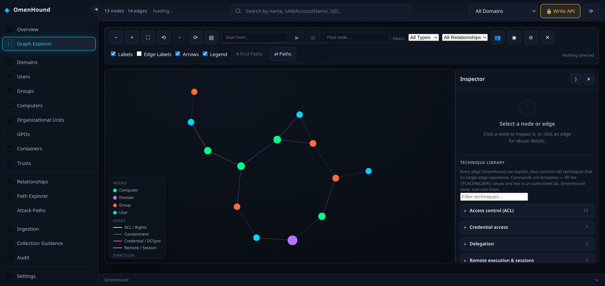
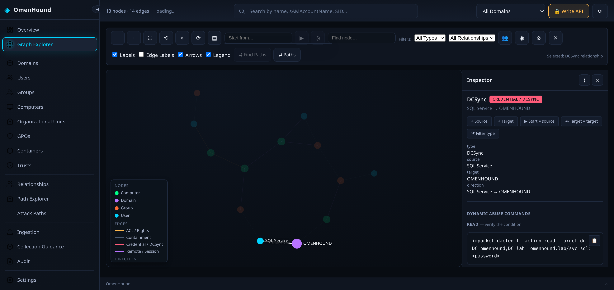
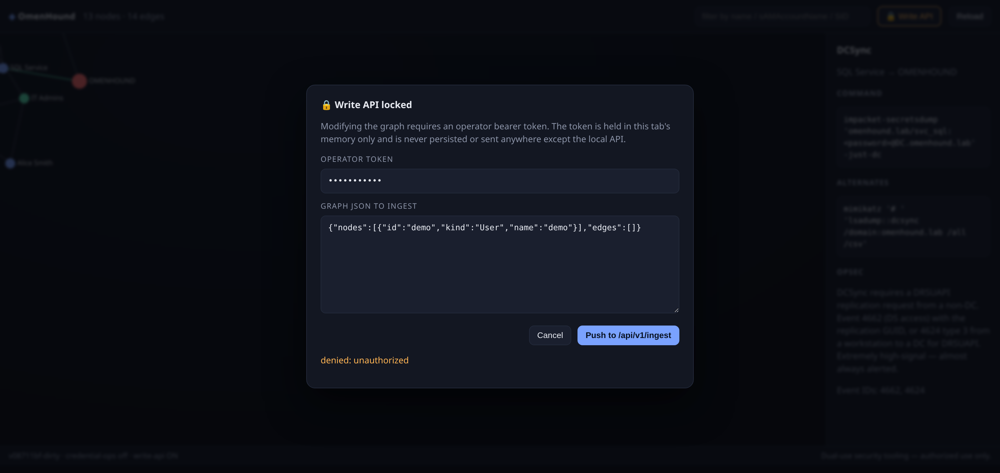

# Web UI Guide

The UI is served by `omenhound serve` at `http://<addr>/`. It is a dependency-free
canvas force graph embedded in the binary — no npm, no bundler, no CDN.

```bash
./bin/omenhound serve --collector sample --addr 127.0.0.1:8080
# open http://127.0.0.1:8080
```

## The attack-path graph



- **Nodes** are coloured by kind (`User`, `Group`, `Computer`, `Domain`, `GPO`, `OU`,
  `Container`, `Trust`); the legend is shown in the empty panel.
- **Edges** are AD relationships. Node labels show `name / sAMAccountName / SID`.
- **Drag** to pan, **scroll** to zoom, **drag a node** to move it.
- The top bar shows `N nodes · M edges`.

The toolbar is grouped by purpose:

| Group | Controls |
|---|---|
| Navigation | zoom out/in, fit, reset, centre selection, re-run layout, show/hide Inspector |
| Start & selection | **Start from…** picker, start/target chips, set start/target from selection, clear path highlight |
| Search | find node (name / SAM / SID) |
| Filtering | node-kind filter, relationship filter, **Sessions only**, isolate, hide unrelated edges, clear selection |
| Display | node labels, edge labels, arrows, legend |
| Analysis | open **Path Explorer** from the starting node |

## Starting node, selection and target

Three roles are kept deliberately separate and are **never inferred** from one another:

- **Selected node** — the entity open in the Inspector.
- **Starting node** — the origin of an analysis. Set it from the *Start from…* picker,
  the Inspector’s *▶ Start here* button, or a relationship row. It persists while you
  inspect other entities.
- **Target node** — the destination used by path analysis.

Picking a result in *Start from…* sets the starting node, selects and centres it, and
shows a `start` chip; the canvas marks it with a **double ring + S badge**. The target is
marked with a **dashed ring + T badge**. Shape and letter carry the meaning, so it
survives greyscale and colour-blind rendering.

## Inspecting a node

Click a node to open the node inspector:

- `kind`, `sid`, `sam`, `domain`, `dn`, plus every collected property.
- **Outgoing** and **Incoming** edge lists — click any entry to jump to that edge's
  abuse panel.
- Collapsible sections for **Memberships & roles**, **Sessions**, **Credentials** and
  **Evidence & provenance** (see below).
- Quick actions: *▶ Start here*, *◎ Target*, *⌖ Focus*, *⇄ Paths*, *⧉ Copy SID*.

Use the header buttons to **collapse** (⟨/⟩) or **hide** (✕) the Inspector; the *Panel*
toolbar button reopens it. Closing the panel no longer clears the selection — `Esc` does.

## Sessions

Where the dataset contains `HasSession` edges (`(User)-[:HasSession]->(Computer)`), the
Inspector’s **Sessions** section lists the observed relationships from both sides, and the
**Sessions only** toggle filters the graph to just those identities and hosts.

OmenHound validates no session metadata, and the collectors emit sessions **without
timestamps or validity**. The UI therefore states only “observed at collection time” and
never asserts an observed / historical / stale / expired status it cannot prove. Absence of
a session is never treated as proof that none exists.

## Credentials

OmenHound does **not** store secrets in the graph, so the Inspector’s **Credentials**
section normally shows an honest empty state. If an importer supplies credential
**references** through the property namespace below, they are rendered masked by default
with an explicit per-value reveal:

```
cred.type        password | nthash | ntlm | kerberos-ticket | token | certificate
cred.source      where the reference came from (collector / import)
cred.ref         an opaque fingerprint or reference id — never the raw secret
cred.observed_at RFC3339 collection timestamp
cred.status      discovered | imported | validated | expired | unknown
```

Raw values never reach the URL, browser storage or logs, and a reference is never treated
as proof that authentication would succeed. The shipped collectors do not emit `cred.*`.

## Path Explorer integration

Set the source and target from the graph (the *⇄ Paths* toolbar button uses the starting
node, or the current selection). The results honour **direction** (outgoing / incoming /
undirected) and node/relationship-type filters, and any path can be pushed back onto the
canvas with **⌖ Show on graph**, highlighting its nodes and edges until cleared. Paths are
graph evidence — a connection is never presented as an exploitable attack path.

## Keyboard shortcuts

Ignored while typing in a form control:

| Key | Action |
|---|---|
| `f` | fit view |
| `r` | reset view |
| `c` | centre selection |
| `/` | focus the node search |
| `Esc` | clear the selection and any highlighted path |

## Abuse panel (per edge)

Click an **edge** (or an entry in the node's edge list) to open the abuse panel. This is
the heart of OmenHound: the command is generated at render time from **your** graph's
real properties.



The panel shows:

| Section | Contents |
|---|---|
| **title / summary** | the edge kind and `source → target` |
| **Command** | a copy-pasteable primary command with real SAM/DN/domain/DC |
| **Alternates** | alternative tooling (impacket, certipy, SharpGPOAbuse, …) |
| **OPSEC** | what the action looks like on the wire / in logs |
| **Event IDs** | Windows event IDs to correlate |
| **⚠ warnings** | emitted whenever a needed property is missing — never a silent gap |

The same rendering is available over HTTP:

```bash
curl -s "http://127.0.0.1:8080/api/v1/abuse?src=<SID>&kind=GenericAll&dst=<SID>" | jq
curl -s "http://127.0.0.1:8080/api/v1/abuse/supported" | jq
```

## Search

Type in the top bar to filter by **name, sAMAccountName, or SID**. Non-matching nodes
are dimmed in place, so you keep the surrounding topology.

## Reload

**Reload** re-fetches `/api/v1/graph` (useful after an ingest) and refreshes the footer
health line: `v<version> · credential-ops ON/off · write-api ON/off`.

## Write-API auth gate

The UI is **read-only by default**. Graph-modifying endpoints require an operator bearer
token, so the UI exposes a gated **Write API** control (top right). Clicking it opens the
auth gate:



- The token is held in **this tab's memory only** and never persisted.
- The gate submits to `POST /api/v1/ingest` with `Authorization: Bearer <token>`.
- A bad/absent token surfaces the **real** server response — the screenshot above shows
  `denied: unauthorized`, which is the actual `401` from the server, not a mock.
- On success the control flips to 🔓 and the graph reloads.

> The gate is a convenience wrapper over the same bearer-token auth the CLI and `curl`
> use. It does not weaken the server-side checks: the token is still required and
> constant-time compared, and every write is audited.

## Ingesting and deleting data

The **Ingestion** view has a **Web Upload** tab and a **CLI / API Guidance** tab.

- **Web Upload** picks a Graph JSON file, takes the same operator token, and sends it to
  `POST /api/v1/ingest`.
- **Replace existing graph** (a checkbox, **off by default**) makes that ingest *replace*
  mode (`?mode=replace`): the current graph is deleted first, so the server ends up holding
  only the file you uploaded. Leave it unchecked to **merge** into what is already there.
  A confirmation dialog always precedes a replace.
- **Delete data** clears the graph on demand: it shows the current node/edge counts and,
  after a confirmation, calls `DELETE /api/v1/graph?confirm=true` with your token. It is
  disabled while the graph is already empty.

Use this to work with **one dataset at a time** rather than accumulating every collection
into a single graph. Both actions reload the graph and reset the selection, start/target
anchors and any path highlight, so nothing keeps pointing at a deleted entity. See the
[API Reference](API-Reference) for the exact `mode` and confirmation semantics.

## Screenshot capture (for maintainers)

`scripts/shots.py` regenerates the images above using Selenium + the system Chromium:

```bash
./bin/omenhound serve --collector sample --addr 127.0.0.1:18091 --api-token operator-secret &
python3 scripts/shots.py http://127.0.0.1:18091 wiki/img
```

It captures the graph, performs a **real edge click** for the abuse panel, and drives the
auth gate with a bad token so the `denied` state is genuine.

## UX tests (for maintainers)

`scripts/graph_ux_test.py` drives a real browser against a running server and asserts the
graph, Inspector, starting-node, session, credential, path and data-management
(replace/delete) behaviours. It ingests a self-contained fixture into a **scratch** server,
so it never touches a real dataset:

```bash
make test-ui
```

Point `BASE` at an existing server to run the checks read-only against its dataset:

```bash
python3 scripts/graph_ux_test.py --base http://127.0.0.1:8080
```

Checks whose evidence is absent from the dataset are reported as **SKIP with a reason** —
never as a pass.

Next: **[Operations & Hardening](Operations-and-Hardening)** →
